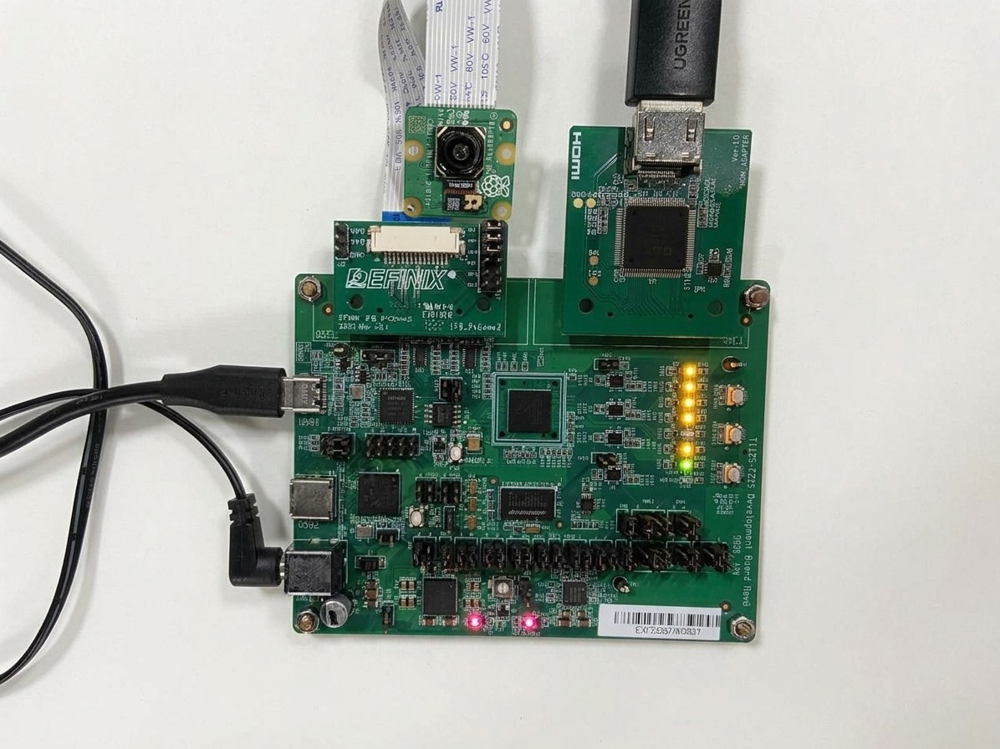

# Ti125F225 Edge Vision SoC — hardware setup

Runs the Edge Vision SoC on the Ti125F225 board:
**Raspberry Pi camera (IMX219 / IMX708) → DDR3L → hardware accelerator → HDMI**.

---

## 1. What you need

**Hardware**

- Ti125F225 board
- Raspberry Pi Camera v2 (IMX219) or v3 (IMX708). The firmware probes both
  and prints which one it found.
- Dual Raspberry Pi Camera daughter card (on **QSE2**, camera ribbon in **FPC1**)
- HDMI adapter daughter card (on **QSE1**), HDMI cable and monitor
- USB cable to **USB1** (FT2232H: JTAG + UART). **USB2** (FX5, USB 3.2) is unused.
- 12 V DC supply into barrel jack **J1**

**Software**

- Efinity **2026.2** and the Efinity RISC-V IDE **2026.2**

> **Warning: Efinity 2026.1.** With Efinity / RISC-V IDE **2026.1** you must edit
> `embedded_sw/SapphireSoc/bsp/efinix/EfxSapphireSoc/openocd/ftdi_ti.cfg` before
> running firmware, or the RISC-V IDE will not find the board (see section 5).
> With **2026.2 and later** no edit is needed.

## 2. Jumpers

IO bank voltages used by `edge_vision_soc.peri.xml`:

```
1A 1.35 V SSTL   2A 1.35 V SSTL   3A 1.8 V LVCMOS   4A unused
1B 1.35 V SSTL   2B 1.2 V LVCMOS  3B 1.8 V LVCMOS   4B 1.8 V LVCMOS
TL 3.3 V LVCMOS  TR 3.3 V LVCMOS  BL 1.8 V LVCMOS   BR 3.3 V LVCMOS
```

**VCCIO bank selects.** PH5/PH6/PH7: 1-2 → 1V8, 3-4 → 3V3.
PH11/PH12/PH13: 1-2 → 1V2, 3-4 → 1V8, 5-6 → 3V3.

| Jumper | Rail       | Set to                   | Why                                                                                          |
| ------ | ---------- | ------------------------ | -------------------------------------------------------------------------------------------- |
| PH5    | VCCIO33_TL | **3-4 (3V3)**      | TL = 3.3 V; X1 (33.33 MHz)                                                                   |
| PH6    | VCCIO33_TR | **3-4 (3V3)**      | TR = 3.3 V; X2 (50 MHz)                                                                      |
| PH7    | VCCIO33_BL | **1-2 (1V8)**      | BL = 1.8 V                                                                                   |
| PH8    | VCCIO33_BR | **fit**            | 3V3 only; UART and JTAG                                                                      |
| PH9    | VCCIO1A_1B | **fit both pairs** | 1V35, DDR3L                                                                                  |
| PH10   | VCCIO2A    | **fit both pairs** | 1V35, DDR3L                                                                                  |
| PH11   | VCCIO2B    | **1-2 (1V2)**      | 2B = 1.2 V (`o_led`)                                                                       |
| PH12   | VCCIO3A_3B | **3-4 (1V8)**      | 3A/3B = 1.8 V (camera I²C, HDMI data, SPI flash, buttons)                                   |
| PH13   | VCCIO4A_4B | **3-4 (1V8)**      | 4B = 1.8 V, carries the 74.25 MHz HDMI PLL reference. Wrong setting → HDMI PLL never locks. |

**Power rails**

| Jumper         | Set to                   | Why                                                                            |
| -------------- | ------------------------ | ------------------------------------------------------------------------------ |
| PH3            | **fit both pairs** | 0V95 → VCC (core)                                                             |
| PH4            | **fit**            | 1V8 → VCCAUX                                                                  |
| **PH28** | **OPEN**           | Fitting it disables the PMIC; the board will not power up.                     |
| PH2            | **fit**            | 3V3 → VDRV (VTT/VREF regulator)                                               |
| **PH1**  | **OPEN**           | Open = 1.35 V (DDR3L, W638GU6RB fitted). Short = 1.5 V, wrong for this memory. |
| PH14           | **fit both pairs** | 1V35 → VDD_DDR3                                                               |
| PH15           | **fit both pairs** | 1V35 → VDDQ_DDR3                                                              |
| PH16           | **fit**            | VREF → VREF_DDR3                                                              |
| PH17           | **fit**            | VTT → VTT_DDR3                                                                |

**Config, clocks, camera**

| Jumper         | Set to                | Why                                                                         |
| -------------- | --------------------- | --------------------------------------------------------------------------- |
| **PH20** | **1-3 and 2-4** | Routes the FTDI to UART. 3-5 / 4-6 gives it to the PMIC I²C → no console. |
| PH21           | open                  | 100 Ω termination on CLK_BR0_25M, not an enable                            |
| PH22           | open                  | Same, on CLK_BL0_74M25                                                      |
| PH27           | board default         | FTDI 3.3 V source                                                           |
| PH19           | open                  | FX5 reset; FX5 unused                                                       |
| **PH18** | **3-4 (3V3)**   | VQSE2: high side of the QSE2 level shifter for camera I²C / reset          |

**Camera daughter card:** fit the three shunts on the card's **J1** (7-8, 9-10, 11-12)
to connect SCL/SDA/EN to the camera on FPC1.

**Clocks** (all oscillators free-run):

```
pll_ddr   PLL_BR0  25.00 MHz  X3   DDR3L controller clocks, i_axi0_mem_clk 100 MHz
pll_sys   PLL_TR0  50.00 MHz  X2   i_soc_clk / i_sys_clk 200 MHz
pll_osc3  PLL_TL1  33.33 MHz  X1   i_pixel_clk 100 MHz (camera), i_sys_clk_25mhz (ADV7511 setup)
pll_osc2  PLL_BL0  74.25 MHz  X4   i_hdmi_clk_148p5MHz / i_hdmi_clk_74p25MHz (HDMI)
```

---

## 3. Connections

1. **Power off** before connecting the camera ribbon.
2. Set the jumpers (section 2). Check **PH1 and PH28 are open**.
3. Camera daughter card → **QSE2**; camera ribbon → **FPC1** (not FPC2), fully seated, latch closed.
4. HDMI adapter card → **QSE1**; HDMI cable → monitor.
5. USB → **USB1** → PC. (Header **J2** is available for an external JTAG pod.)
6. 12 V → **J1**, power on, open the serial terminal.

### Hardware setup photo


*1 12 V jack J1 · 2 camera card on QSE2 · 3 ribbon in FPC1 · 4 HDMI adapter card on QSE1 ·
5 USB1 JTAG/UART · 6 VCCIO jumper block (PH5–PH13) · 7 PH1 and PH28 open · 8 PH20 set to UART*

---

## 4. Buttons and LEDs

| Control        | Signal / pin            | Function                                                                         |
| -------------- | ----------------------- | -------------------------------------------------------------------------------- |
| **BTN2** | `i_sw[0]`, GPIOR_N_00 | Reset (SoC, DDR3L calibration, camera/display)                                   |
| **BTN1** | `i_sw[1]`, GPIOR_P_02 | `evsoc_ispExample_demo2`: step the demo mode 0→1→2→3→0 (counts on release) |
| BTN3           | CRESET_N                | Reconfigure the FPGA from flash                                                  |

BTN1 is the FPGA's CSI configuration pin: **do not hold it while the FPGA is configuring**.

| LED          | Meaning                                                                                                                                                                                                  |
| ------------ | -------------------------------------------------------------------------------------------------------------------------------------------------------------------------------------------------------- |
| `o_led[1]` | DDR3L status. **Solid = calibrated OK.** Otherwise it repeats a blink code: 1 = in reset, 2 = calibrating, 3 = calibration failed (retrying), 4 = calibrated after retries, 5 = retries exhausted. |
| `o_led[0]` | Heartbeat (1 Hz), only once the ADV7511 HDMI transmitter has been configured. Dark = HDMI setup did not finish.                                                                                          |

---

## 5. Program and run

1. **Bitstream:** open `edge_vision_soc.xml` in Efinity, compile, and program
   `outflow/edge_vision_soc.bit` over USB1 (JTAG) with the Efinity Programmer.
   Wait for `o_led[1]` to go solid (DDR3L calibrated).
2. **Firmware:** import `embedded_sw/SapphireSoc` into the Efinity RISC-V IDE,
   build an application and run it with its `*_ti.launch` debug configuration.

   > **Efinity 2026.1 only:** first edit
   > `bsp/efinix/EfxSapphireSoc/openocd/ftdi_ti.cfg` so it contains:
   >
   > ```
   > set _CPUTAPID 0x006E0A79
   > ftdi device_desc "Titanium Ti125F225 Dev Board"
   > ftdi vid_pid 0x0403 0x6010
   > ```
   >
   > `device_desc` must be the board name the Efinity Programmer shows.
   > Without this edit the RISC-V IDE reports no device found.
   > Efinity **2026.2 and later** need no edit.
   >

| Application                    | What it does                                                       |
| ------------------------------ | ------------------------------------------------------------------ |
| `evsoc_ispExample_demo`      | Select the mode with keys **a–g** on the UART               |
| `evsoc_ispExample_demo2`     | Select the mode with **BTN1** (prints `Demo mode -> n`)    |
| `evsoc_ispExample`           | Basic camera → display pipeline                                   |
| `evsoc_ispExample_timestamp` | System profiling: frame-processing time and camera FPS on the UART |
| `evsoc_selfCheck`            | SoC self-test suite                                                |

A good boot (`evsoc_ispExample_demo2`):

```
Hello Efinix Edge Vision SoC!!

Init Camera.....Camera0 detected: PiCam v3 (IMX708) (addr: 0x0000001A)
Done Camera Init
Done !!
Init DMA.....Done !!

Initialize test display content..
Trigger display DMA..
Done !!
...
Press BTN1 to step the demo mode. Current mode: 0
```

Colour bars show for 5 s, then the live camera image.

---

## 6. Changing the resolution

The camera always streams 1920×1080; only processing and display change.

1. `evsoc_defines.v`: enable exactly one of `Full_HD_1920x1080_60Hz` (default),
   `HD_Ready_1280x720_60Hz`, `SD_640x480_60Hz`.
2. Interface Designer: set the `hdmi_yuv_clk` output clock to
   `i_hdmi_clk_148p5MHz` (1080p), `i_hdmi_clk_74p25MHz` (720p) or
   `i_sys_clk_25mhz` (640×480; Ti125 has no 25.25 MHz output).
3. Firmware: set `FRAME_WIDTH` / `FRAME_HEIGHT` in the app's `src/board_config.h`
   (or regenerate it with the evsoc structure generator), then rebuild.

---

## 7. Troubleshootin

# Ti125F225 Edge Vision SoC — hardware setup

Runs the Edge Vision SoC on the Ti125F225 board:
**Raspberry Pi camera (IMX219 / IMX708) → DDR3L → hardware accelerator → HDMI**.

---

## 1. What you need

**Hardware**

- Ti125F225 board
- Raspberry Pi Camera v2 (IMX219) or v3 (IMX708). The firmware probes both
  and prints which one it found.
- Dual Raspberry Pi Camera daughter card (on **QSE2**, camera ribbon in **FPC1**)
- HDMI adapter daughter card (on **QSE1**), HDMI cable and monitor
- USB cable to **USB1** (FT2232H: JTAG + UART). **USB2** (FX5, USB 3.2) is unused.
- 12 V DC supply into barrel jack **J1**

**Software**

- Efinity **2026.1** and the Efinity RISC-V IDE **2026.1**

## 2. Jumpers

IO bank voltages used by `edge_vision_soc.peri.xml`:

```
1A 1.35 V SSTL   2A 1.35 V SSTL   3A 1.8 V LVCMOS   4A unused
1B 1.35 V SSTL   2B 1.2 V LVCMOS  3B 1.8 V LVCMOS   4B 1.8 V LVCMOS
TL 3.3 V LVCMOS  TR 3.3 V LVCMOS  BL 1.8 V LVCMOS   BR 3.3 V LVCMOS
```

**VCCIO bank selects.** PH5/PH6/PH7: 1-2 → 1V8, 3-4 → 3V3.
PH11/PH12/PH13: 1-2 → 1V2, 3-4 → 1V8, 5-6 → 3V3.

| Jumper | Rail       | Set to                   | Why                                                                                          |
| ------ | ---------- | ------------------------ | -------------------------------------------------------------------------------------------- |
| PH5    | VCCIO33_TL | **3-4 (3V3)**      | TL = 3.3 V; X1 (33.33 MHz)                                                                   |
| PH6    | VCCIO33_TR | **3-4 (3V3)**      | TR = 3.3 V; X2 (50 MHz)                                                                      |
| PH7    | VCCIO33_BL | **1-2 (1V8)**      | BL = 1.8 V                                                                                   |
| PH8    | VCCIO33_BR | **fit**            | 3V3 only; UART and JTAG                                                                      |
| PH9    | VCCIO1A_1B | **fit both pairs** | 1V35, DDR3L                                                                                  |
| PH10   | VCCIO2A    | **fit both pairs** | 1V35, DDR3L                                                                                  |
| PH11   | VCCIO2B    | **1-2 (1V2)**      | 2B = 1.2 V (`o_led`)                                                                       |
| PH12   | VCCIO3A_3B | **3-4 (1V8)**      | 3A/3B = 1.8 V (camera I²C, HDMI data, SPI flash, buttons)                                   |
| PH13   | VCCIO4A_4B | **3-4 (1V8)**      | 4B = 1.8 V, carries the 74.25 MHz HDMI PLL reference. Wrong setting → HDMI PLL never locks. |

**Power rails**

| Jumper         | Set to                   | Why                                                                            |
| -------------- | ------------------------ | ------------------------------------------------------------------------------ |
| PH3            | **fit both pairs** | 0V95 → VCC (core)                                                             |
| PH4            | **fit**            | 1V8 → VCCAUX                                                                  |
| **PH28** | **OPEN**           | Fitting it disables the PMIC; the board will not power up.                     |
| PH2            | **fit**            | 3V3 → VDRV (VTT/VREF regulator)                                               |
| **PH1**  | **OPEN**           | Open = 1.35 V (DDR3L, W638GU6RB fitted). Short = 1.5 V, wrong for this memory. |
| PH14           | **fit both pairs** | 1V35 → VDD_DDR3                                                               |
| PH15           | **fit both pairs** | 1V35 → VDDQ_DDR3                                                              |
| PH16           | **fit**            | VREF → VREF_DDR3                                                              |
| PH17           | **fit**            | VTT → VTT_DDR3                                                                |

**Config, clocks, camera**

| Jumper         | Set to                | Why                                                                         |
| -------------- | --------------------- | --------------------------------------------------------------------------- |
| **PH20** | **1-3 and 2-4** | Routes the FTDI to UART. 3-5 / 4-6 gives it to the PMIC I²C → no console. |
| PH21           | open                  | 100 Ω termination on CLK_BR0_25M, not an enable                            |
| PH22           | open                  | Same, on CLK_BL0_74M25                                                      |
| PH27           | board default         | FTDI 3.3 V source                                                           |
| PH19           | open                  | FX5 reset; FX5 unused                                                       |
| **PH18** | **3-4 (3V3)**   | VQSE2: high side of the QSE2 level shifter for camera I²C / reset          |

**Camera daughter card:** fit the three shunts on the card's **J1** (7-8, 9-10, 11-12)
to connect SCL/SDA/EN to the camera on FPC1.

**Clocks** (all oscillators free-run):

```
pll_ddr   PLL_BR0  25.00 MHz  X3   DDR3L controller clocks, i_axi0_mem_clk 100 MHz
pll_sys   PLL_TR0  50.00 MHz  X2   i_soc_clk / i_sys_clk 200 MHz
pll_osc3  PLL_TL1  33.33 MHz  X1   i_pixel_clk 100 MHz (camera), i_sys_clk_25mhz (ADV7511 setup)
pll_osc2  PLL_BL0  74.25 MHz  X4   i_hdmi_clk_148p5MHz / i_hdmi_clk_74p25MHz (HDMI)
```

---

## 3. Connections

1. **Power off** before connecting the camera ribbon.
2. Set the jumpers (section 2). Check **PH1 and PH28 are open**.
3. Camera daughter card → **QSE2**; camera ribbon → **FPC1** (not FPC2), fully seated, latch closed.
4. HDMI adapter card → **QSE1**; HDMI cable → monitor.
5. USB → **USB1** → PC. (Header **J2** is available for an external JTAG pod.)
6. 12 V → **J1**, power on, open the serial terminal.

### Hardware setup photo



*1 12 V jack J1 · 2 camera card on QSE2 · 3 ribbon in FPC1 · 4 HDMI adapter card on QSE1 ·
5 USB1 JTAG/UART · 6 VCCIO jumper block (PH5–PH13) · 7 PH1 and PH28 open · 8 PH20 set to UART*

---

## 4. Buttons and LEDs

| Control        | Signal / pin            | Function                                                                         |
| -------------- | ----------------------- | -------------------------------------------------------------------------------- |
| **BTN2** | `i_sw[0]`, GPIOR_N_00 | Reset (SoC, DDR3L calibration, camera/display)                                   |
| **BTN1** | `i_sw[1]`, GPIOR_P_02 | `evsoc_ispExample_demo2`: step the demo mode 0→1→2→3→0 (counts on release) |
| BTN3           | CRESET_N                | Reconfigure the FPGA from flash                                                  |

BTN1 is the FPGA's CSI configuration pin: **do not hold it while the FPGA is configuring**.

| LED          | Meaning                                                                                                                                                                                                  |
| ------------ | -------------------------------------------------------------------------------------------------------------------------------------------------------------------------------------------------------- |
| `o_led[1]` | DDR3L status. **Solid = calibrated OK.** Otherwise it repeats a blink code: 1 = in reset, 2 = calibrating, 3 = calibration failed (retrying), 4 = calibrated after retries, 5 = retries exhausted. |
| `o_led[0]` | Heartbeat (1 Hz), only once the ADV7511 HDMI transmitter has been configured. Dark = HDMI setup did not finish.                                                                                          |

---

## 5. Program and run

1. **Bitstream:** open `edge_vision_soc.xml` in Efinity, compile, and program
   `outflow/edge_vision_soc.bit` over USB1 (JTAG) with the Efinity Programmer.
   Wait for `o_led[1]` to go solid (DDR3L calibrated).
2. **Firmware:** import `embedded_sw/SapphireSoc` into the Efinity RISC-V IDE,
   build an application and run it with its `*_ti.launch` debug configuration.

| Application                    | What it does                                                       |
| ------------------------------ | ------------------------------------------------------------------ |
| `evsoc_ispExample_demo`      | Select the mode with keys **a–g** on the UART               |
| `evsoc_ispExample_demo2`     | Select the mode with **BTN1** (prints `Demo mode -> n`)    |
| `evsoc_ispExample`           | Basic camera → display pipeline                                   |
| `evsoc_ispExample_timestamp` | System profiling: frame-processing time and camera FPS on the UART |
| `evsoc_selfCheck`            | SoC self-test suite                                                |

A good boot (`evsoc_ispExample_demo2`):

```
Hello Efinix Edge Vision SoC!!

Init Camera.....Camera0 detected: PiCam v3 (IMX708) (addr: 0x0000001A)
Done Camera Init
Done !!
Init DMA.....Done !!

Initialize test display content..
Trigger display DMA..
Done !!
...
Press BTN1 to step the demo mode. Current mode: 0
```

Colour bars show for 5 s, then the live camera image.

---

## 6. Changing the resolution

The camera always streams 1920×1080; only processing and display change.

1. `evsoc_defines.v`: enable exactly one of `Full_HD_1920x1080_60Hz` (default),
   `HD_Ready_1280x720_60Hz`, `SD_640x480_60Hz`.
2. Interface Designer: set the `hdmi_yuv_clk` output clock to
   `i_hdmi_clk_148p5MHz` (1080p), `i_hdmi_clk_74p25MHz` (720p) or
   `i_sys_clk_25mhz` (640×480; Ti125 has no 25.25 MHz output).
3. Firmware: set `FRAME_WIDTH` / `FRAME_HEIGHT` in the app's `src/board_config.h`
   (or regenerate it with the evsoc structure generator), then rebuild.

---

## 7. Troubleshooting

| Symptom                            | Likely cause                                                                                                                                                                |
| ---------------------------------- | --------------------------------------------------------------------------------------------------------------------------------------------------------------------------- |
| Board does not power up            | PH28 fitted                                                                                                                                                                 |
| `o_led[1]` never solid           | DDR3L calibration: check PH1 open (1.35 V) and PH9/PH10/PH14–PH17 fitted                                                                                                   |
| No UART output                     | PH20 not on 1-3 / 2-4, or wrong COM port (UART is FT2232H channel A)                                                                                                        |
| `o_led[0]` dark / no HDMI signal | ADV7511 setup or HDMI PLL: check PH13 on 3-4 and the QSE1 adapter card                                                                                                      |
| No camera detected                 | Ribbon not seated or in FPC2, J1 shunts missing on the camera card, PH18 not on 3-4                                                                                         |
| RISC-V IDE finds no device         | In `bsp/efinix/EfxSapphireSoc/openocd/ftdi_ti.cfg` use CPUTAPID `0x006E0A79`, vid/pid `0x0403 0x6010`, and the board name the Efinity Programmer shows as device_desc |
