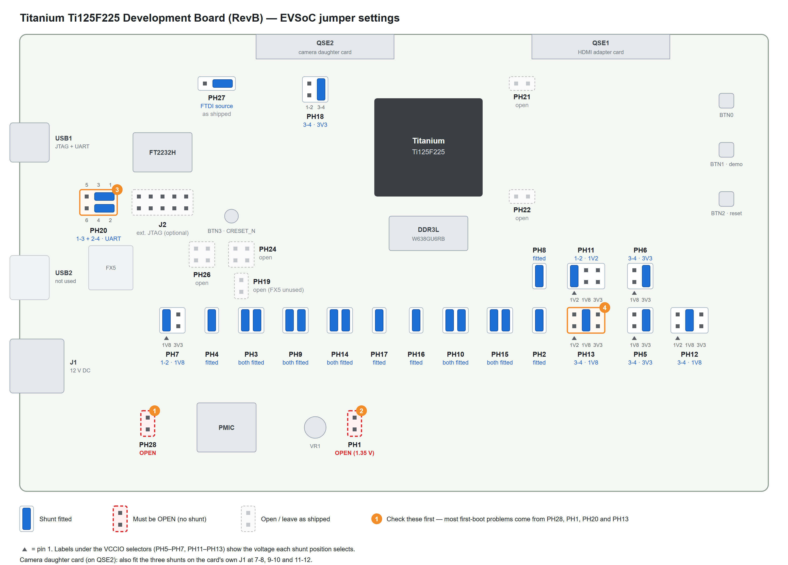
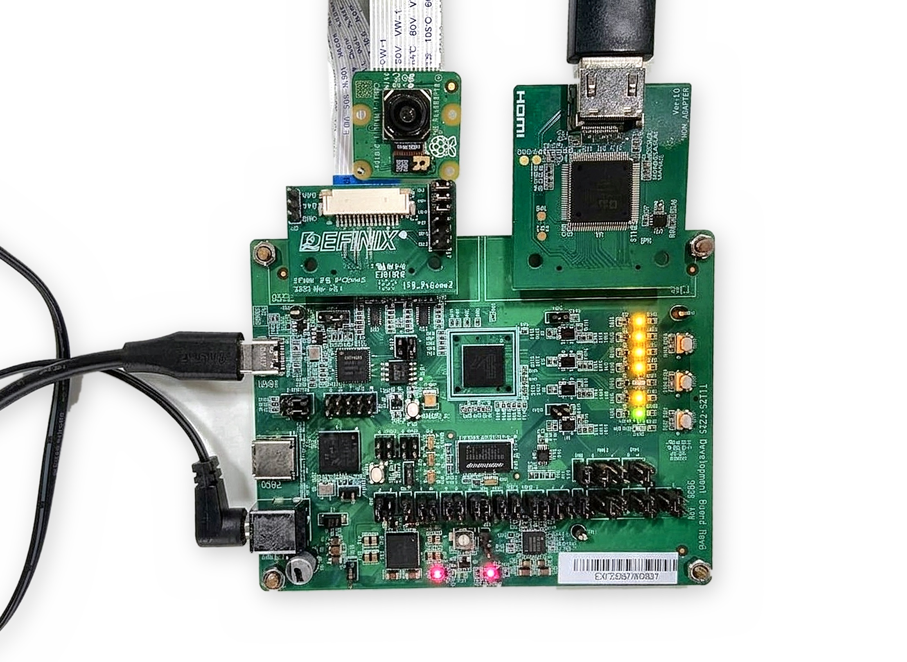

# Edge Vision SoC (EVSoC) — Titanium Ti125F225


Edge Vision SoC reference design for the **Titanium Ti125F225 Development Board**:

**Raspberry Pi camera (IMX219 / IMX708) → DDR3L → hardware accelerator → HDMI**

## Contents

- [Requirements](#requirements)
- [Documentation](#documentation)
- [Board Configuration](#board-configuration)
  - [IO Bank Voltages](#io-bank-voltages)
  - [VCCIO Jumpers](#vccio-jumpers)
  - [Power Rail Jumpers](#power-rail-jumpers)
  - [Configuration, Clock and Camera Jumpers](#configuration-clock-and-camera-jumpers)
  - [Clocks](#clocks)
- [Hardware Setup](#hardware-setup)
- [Buttons and LEDs](#buttons-and-leds)
- [Quick Start](#quick-start)
- [Example Applications](#example-applications)
- [Changing the Display Resolution](#changing-the-display-resolution)
- [Troubleshooting](#troubleshooting)

---

## Requirements

### Hardware

| Item | Notes |
| --- | --- |
| Titanium Ti125F225 Development Board | |
| Raspberry Pi Camera v2 (IMX219) or v3 (IMX708) | The firmware probes for both and reports which one it found. |
| Dual Raspberry Pi Camera daughter card | Mounted on **QSE2**; camera ribbon in **FPC1**. |
| HDMI adapter daughter card | Mounted on **QSE1**, plus an HDMI cable and monitor. |
| USB cable | To **USB1** (FT2232H: JTAG + UART). **USB2** (FX5, USB 3.2) is not used. |
| 12 V DC power supply | Into barrel jack **J1**. |

### Software

| Tool | Version |
| --- | --- |
| Efinity | 2026.2 or later |
| Efinity RISC-V Embedded Software IDE | 2026.2 or later |
| Serial terminal | 115200 baud, 8N1 |

> ⚠️ **Efinity 2026.1:** a one-time OpenOCD config edit is needed before the RISC-V IDE can find the board. See [Quick Start, step 3](#quick-start).

## Documentation

- [Titanium Ti125F225 Development Board Schematics v1.0](https://www.efinixinc.com/docs/ti125f225-dev-board-schematics-v1.0.pdf)

---

## Board Configuration

> 💡 Check the jumpers before applying power. Most first-boot problems come from **PH1**, **PH28**, **PH13** or **PH20**.

The diagram shows every jumper this design needs, at its location on the board. A blue bar is a fitted shunt. Red dashed jumpers must be left open. The tables below give the same settings with the reason for each.



### IO Bank Voltages

Bank voltages used by `edge_vision_soc.peri.xml`:

| Bank | Voltage / Standard | Bank | Voltage / Standard | Bank | Voltage / Standard |
| --- | --- | --- | --- | --- | --- |
| 1A | 1.35 V SSTL | 2A | 1.35 V SSTL | 3A | 1.8 V LVCMOS |
| 1B | 1.35 V SSTL | 2B | 1.2 V LVCMOS | 3B | 1.8 V LVCMOS |
| 4A | unused | 4B | 1.8 V LVCMOS | TL | 3.3 V LVCMOS |
| TR | 3.3 V LVCMOS | BL | 1.8 V LVCMOS | BR | 3.3 V LVCMOS |

### VCCIO Jumpers

Selector positions: **PH5 / PH6 / PH7**: 1-2 = 1V8, 3-4 = 3V3. **PH11 / PH12 / PH13**: 1-2 = 1V2, 3-4 = 1V8, 5-6 = 3V3.

| Jumper | Rail | Setting | Notes |
| --- | --- | --- | --- |
| PH5 | VCCIO33_TL | **3-4 (3V3)** | TL = 3.3 V; X1 (33.33 MHz) |
| PH6 | VCCIO33_TR | **3-4 (3V3)** | TR = 3.3 V; X2 (50 MHz) |
| PH7 | VCCIO33_BL | **1-2 (1V8)** | BL = 1.8 V |
| PH8 | VCCIO33_BR | **Fitted** | 3V3 only; UART and JTAG |
| PH9 | VCCIO1A_1B | **Both pairs fitted** | 1V35, DDR3L |
| PH10 | VCCIO2A | **Both pairs fitted** | 1V35, DDR3L |
| PH11 | VCCIO2B | **1-2 (1V2)** | 2B = 1.2 V (`o_led`) |
| PH12 | VCCIO3A_3B | **3-4 (1V8)** | 3A/3B = 1.8 V (camera I²C, HDMI data, SPI flash, buttons) |
| PH13 | VCCIO4A_4B | **3-4 (1V8)** | 4B = 1.8 V, carries the 74.25 MHz HDMI PLL reference. A wrong setting stops the HDMI PLL from locking. |

### Power Rail Jumpers

| Jumper | Setting | Notes |
| --- | --- | --- |
| PH3 | **Both pairs fitted** | 0V95 → VCC (core) |
| PH4 | **Fitted** | 1V8 → VCCAUX |
| **PH28** | **Open** | ⚠️ Fitting it disables the PMIC and the board will not power up. |
| PH2 | **Fitted** | 3V3 → VDRV (VTT/VREF regulator) |
| **PH1** | **Open** | ⚠️ Open = 1.35 V (DDR3L, W638GU6RB fitted). Shorted = 1.5 V, which is wrong for this memory. |
| PH14 | **Both pairs fitted** | 1V35 → VDD_DDR3 |
| PH15 | **Both pairs fitted** | 1V35 → VDDQ_DDR3 |
| PH16 | **Fitted** | VREF → VREF_DDR3 |
| PH17 | **Fitted** | VTT → VTT_DDR3 |

### Configuration, Clock and Camera Jumpers

| Jumper | Setting | Notes |
| --- | --- | --- |
| **PH20** | **1-3 and 2-4** | Routes the FTDI to the UART. 3-5 / 4-6 routes it to the PMIC I²C instead, so there is no console. |
| PH21 | Open | 100 Ω termination on CLK_BR0_25M (not an enable) |
| PH22 | Open | 100 Ω termination on CLK_BL0_74M25 (not an enable) |
| PH27 | **As shipped**: shunt on the two pins nearest QSE2 | FTDI source selector (1×3 header between USB1 and QSE2) |
| PH24 | Open | 2×2 header below J2 |
| PH26 | Open | 2×2 header below J2, left of PH24 |
| PH19 | Open | Below PH24. FX5 reset; FX5 is not used |
| **PH18** | **3-4 (3V3)** | VQSE2: high side of the QSE2 level shifter for camera I²C and reset |

**Camera daughter card:** fit the three shunts on the card's **J1** (7-8, 9-10, 11-12) to connect SCL, SDA and EN to the camera on FPC1.

### Clocks

All oscillators are free-running.

| PLL | Instance | Reference | Source | Outputs |
| --- | --- | --- | --- | --- |
| `pll_ddr` | PLL_BR0 | 25.00 MHz | X3 | DDR3L controller clocks, `i_axi0_mem_clk` (100 MHz) |
| `pll_sys` | PLL_TR0 | 50.00 MHz | X2 | `i_soc_clk` / `i_sys_clk` (200 MHz) |
| `pll_osc3` | PLL_TL1 | 33.33 MHz | X1 | `i_pixel_clk` (100 MHz, camera), `i_sys_clk_25mhz` (ADV7511 setup) |
| `pll_osc2` | PLL_BL0 | 74.25 MHz | X4 | `i_hdmi_clk_148p5MHz` / `i_hdmi_clk_74p25MHz` (HDMI) |

---

## Hardware Setup

1. **Power off** the board before connecting the camera ribbon.
2. Set the jumpers as shown in the [jumper diagram](#board-configuration). Confirm that **PH1 and PH28 are open**.
3. Mount the camera daughter card on **QSE2**. Insert the camera ribbon into **FPC1** (not FPC2), fully seated with the latch closed.
4. Mount the HDMI adapter card on **QSE1** and connect the HDMI cable to the monitor.
5. Connect **USB1** to the PC. Header **J2** is available for an external JTAG pod.
6. Connect 12 V to **J1**, power on, and open the serial terminal (115200 8N1).



*1: 12 V jack J1 · 2: camera card on QSE2 · 3: ribbon in FPC1 · 4: HDMI adapter card on QSE1 · 5: USB1 (JTAG/UART) · 6: VCCIO jumper block (PH5–PH13) · 7: PH1 and PH28 open · 8: PH20 set to UART*

---

## Buttons and LEDs

| Control | Signal / Pin | Function |
| --- | --- | --- |
| **BTN2** | `i_sw[0]`, GPIOR_N_00 | Reset (SoC, DDR3L calibration, camera and display) |
| **BTN1** | `i_sw[1]`, GPIOR_P_02 | In `evsoc_ispExample_demo2`: steps the demo mode 0 → 1 → 2 → 3 → 0 (counts on release) |
| BTN3 | CRESET_N | Reconfigures the FPGA from flash |

> ⚠️ BTN1 shares its pin with an FPGA configuration input. **Do not hold BTN1 while the FPGA is configuring.**

| LED | Meaning |
| --- | --- |
| `o_led[1]` | DDR3L status. **Solid = calibrated OK.** Otherwise it repeats a blink code: 1 = in reset, 2 = calibrating, 3 = calibration failed (retrying), 4 = calibrated after retries, 5 = retries exhausted. |
| `o_led[0]` | 1 Hz heartbeat, which starts only after the ADV7511 HDMI transmitter is configured. Dark = HDMI setup did not finish. |

---

## Quick Start

1. **Build and program the bitstream.** Open `edge_vision_soc.xml` in Efinity, compile, and program `outflow/edge_vision_soc.bit` over USB1 (JTAG) with the Efinity Programmer. Wait for `o_led[1]` to go solid (DDR3L calibrated).

2. **Import the firmware.** Import `embedded_sw/SapphireSoc` into the Efinity RISC-V Embedded Software IDE and build one of the [example applications](#example-applications).

3. **Efinity 2026.1 only: patch the OpenOCD config.** Efinity 2026.1 generates the OpenOCD config with the **Ti60F225 Development Kit** values, so the RISC-V IDE reports that no device was found. Efinity 2026.2 and later generate the correct file. Skip this step on those versions.

   After generating the SoC, open:

   ```text
   embedded_sw/SapphireSoc/bsp/efinix/EfxSapphireSoc/openocd/ftdi_ti.cfg
   ```

   Change **exactly three lines** near the top of the file. Leave every other line as it is.

   | Line | Generated by Efinity 2026.1 (Ti60F225) | Change to (Ti125F225) |
   | --- | --- | --- |
   | 8 | `set _CPUTAPID 0x10660A79` | `set _CPUTAPID 0x006E0A79` |
   | 13 | `ftdi device_desc "Titanium Ti60F225 Development Kit"` | `ftdi device_desc "Titanium Ti125F225 Dev Board"` |
   | 14 | `ftdi vid_pid 0x0403 0x6011` | `ftdi vid_pid 0x0403 0x6010` |

   The same change as a diff (`-` = remove, `+` = add):

   ```diff
    if { [info exists CPUTAPID] } {
       set _CPUTAPID $CPUTAPID
    } else {
      # set useful default
   -   set _CPUTAPID 0x10660A79
   +   set _CPUTAPID 0x006E0A79
    }

    if { $LEGACY_IDE == 0 } {
        adapter driver ftdi
   -    ftdi device_desc "Titanium Ti60F225 Development Kit"
   -    ftdi vid_pid 0x0403 0x6011
   +    ftdi device_desc "Titanium Ti125F225 Dev Board"
   +    ftdi vid_pid 0x0403 0x6010
   ```

   - `_CPUTAPID` is the JTAG ID of the Ti125F225 FPGA.
   - `device_desc` must match the board name shown in the Efinity Programmer **exactly**, including capitals and spaces.
   - `vid_pid 0x0403 0x6010` is the FT2232H on this board. The Ti60F225 kit uses `0x6011`.
   - Edit only the `if { $LEGACY_IDE == 0 }` block shown above. The `ftdi_device_desc` / `ftdi_vid_pid` lines further down the file belong to the legacy block and are not used.
   - Regenerating the SoC overwrites this file, so make the edit again after every regeneration.

4. **Run.** Launch the application with its `*_ti.launch` debug configuration.

Expected UART output for `evsoc_ispExample_demo2`:

```text
Hello Efinix Edge Vision SoC!!

Init Camera.....Camera0 detected: PiCam v3 (IMX708) (addr: 0x0000001A)
Done Camera Init
Done !!
Init DMA.....Done !!

Initialize test display content..
Trigger display DMA..
Done !!
...
Press BTN1 to step the demo mode. Current mode: 0
```

Color bars are shown for 5 seconds, followed by the live camera image.

---

## Example Applications

| Application | Description |
| --- | --- |
| `evsoc_ispExample_demo` | Select the demo mode with keys **a–g** on the UART |
| `evsoc_ispExample_demo2` | Select the demo mode with **BTN1** (prints `Demo mode -> n`) |
| `evsoc_ispExample` | Basic camera → display pipeline |
| `evsoc_ispExample_timestamp` | System profiling: frame-processing time and camera FPS on the UART |
| `evsoc_selfCheck` | SoC self-test suite |

---

## Changing the Display Resolution

The camera always streams 1920×1080. Only the processing and display resolution change.

1. **RTL:** in `evsoc_defines.v`, enable exactly one of:
   - `Full_HD_1920x1080_60Hz` (default)
   - `HD_Ready_1280x720_60Hz`
   - `SD_640x480_60Hz`
2. **Interface Designer:** set the `hdmi_yuv_clk` output clock to:

   | Resolution | Clock |
   | --- | --- |
   | 1920×1080 | `i_hdmi_clk_148p5MHz` |
   | 1280×720 | `i_hdmi_clk_74p25MHz` |
   | 640×480 | `i_sys_clk_25mhz` (the Ti125 design has no 25.25 MHz output) |

3. **Firmware:** set `FRAME_WIDTH` / `FRAME_HEIGHT` in the application's `src/board_config.h` (or regenerate it with the EVSoC structure generator), then rebuild.

---

## Troubleshooting

| Symptom | Likely Cause |
| --- | --- |
| Board does not power up | PH28 is fitted. |
| `o_led[1]` never goes solid | DDR3L calibration failed. Check that PH1 is open (1.35 V) and that PH9, PH10 and PH14–PH17 are fitted. |
| No UART output | PH20 is not on 1-3 / 2-4, or the wrong COM port is open (the UART is FT2232H channel A). |
| `o_led[0]` dark / no HDMI signal | ADV7511 setup or HDMI PLL failed. Check that PH13 is on 3-4 and the QSE1 adapter card is seated. |
| No camera detected | Ribbon not seated or in FPC2, J1 shunts missing on the camera card, or PH18 not on 3-4. |
| RISC-V IDE finds no device | Efinity 2026.1 needs the OpenOCD config edit in [Quick Start, step 3](#quick-start). Not needed on 2026.2 and later. |
